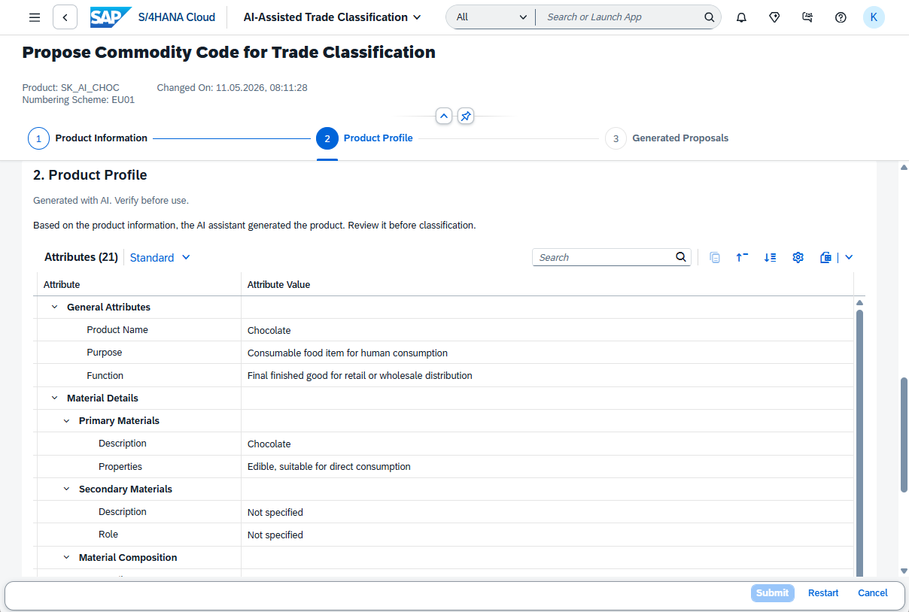
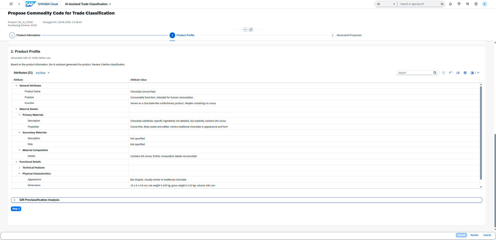

## International Trade Product Profile Agent

**Identifier:** J2362 | [Discovery Center](https://discovery-center.cloud.sap/protected/index.html#/ai-agent/d0fdba4e-20b8-4970-afd4-ea37bf062506/)

### Objective

Unifies product data and semantic insights to deliver complete trade-ready product profiles. The agent aggregates material master data, classification information, and trade attributes to build a comprehensive profile that supports export licensing, customs declarations, and trade compliance processes.

### What It Can Do

- Aggregate material master data, classifications, and trade attributes into a unified product profile
- Surface relevant trade compliance information for a product (export control, embargo status, license requirements)
- Support the preparation of trade documentation by providing complete and accurate product data
- Reduce the effort of manually consolidating product information from multiple sources

### Works With

- SAP S/4HANA Cloud Public Edition

### Example Prompts

| Prompt |
|--------|
| "Show me the trade profile for material [material ID]." |
| "What are the export control attributes for product [product ID]?" |
| "Build a trade-ready product profile for material [material ID]." |

> **Note:** Full capabilities and example prompts will be updated here once additional documentation becomes available.

## Screenshots

