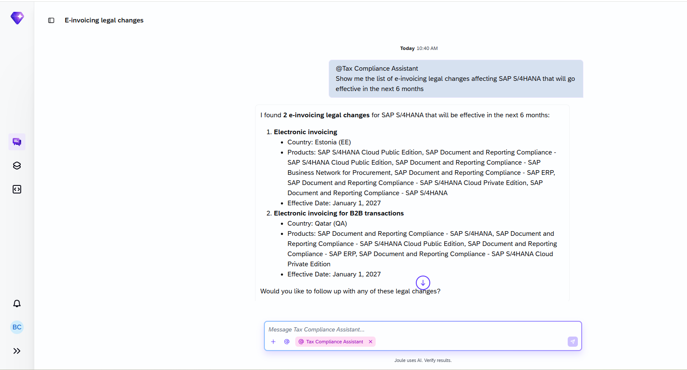

## Legal Change Agent

**Identifier:** J1699 | [Discovery Center](https://discovery-center.cloud.sap/protected/index.html#/ai-agent/7cf097fb-a70e-4fc8-a6f5-c785d392e975/)

### Objective

Enables regulatory compliance discovery for customers by surfacing relevant legal changes that may impact their SAP configuration and reporting obligations. The agent helps tax and compliance teams stay informed about new and upcoming regulatory requirements.

### What It Can Do

- Discover regulatory and legal changes relevant to specific countries or regions
- Surface SAP notes and updates related to compliance requirements
- Help teams understand the impact of legal changes on their SAP system configuration
- Reduce the manual effort of tracking regulatory developments

### Works With

- SAP S/4HANA Cloud Public Edition

### Example Prompts

| Prompt |
|--------|
| "What regulatory changes apply to [country] in [year]?" |
| "Show me legal changes affecting VAT reporting for [country]." |
| "Are there any new compliance requirements I should know about?" |

> **Note:** Full capabilities and example prompts will be updated here once additional documentation becomes available.

## Screenshots

