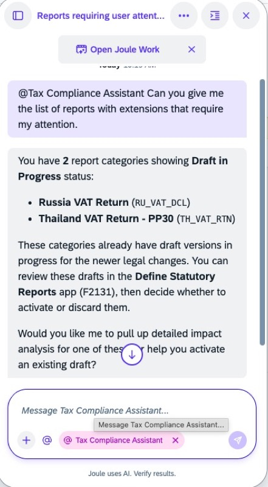
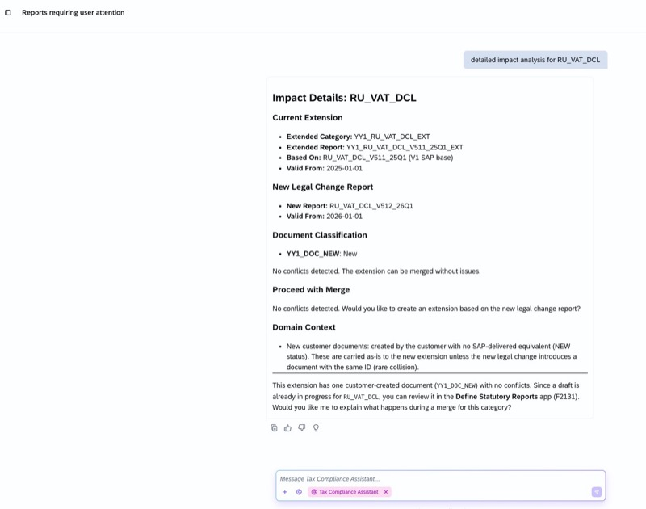
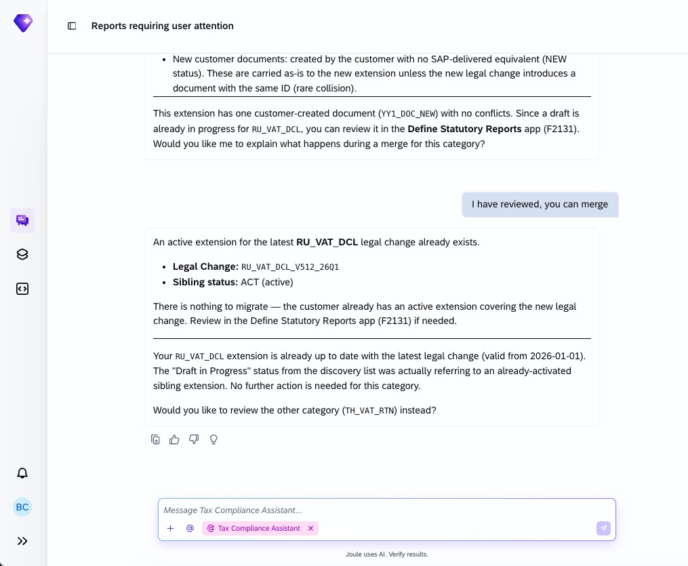
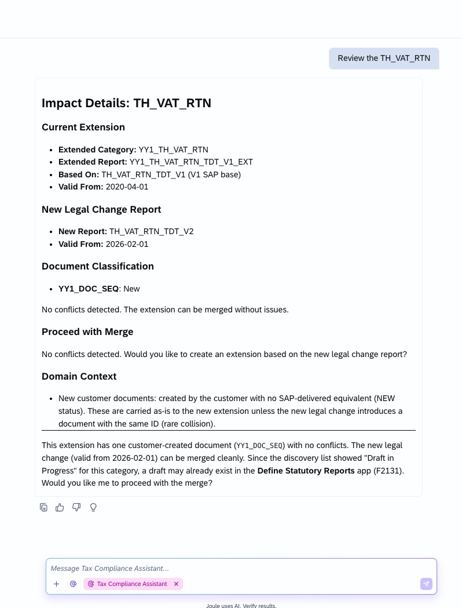
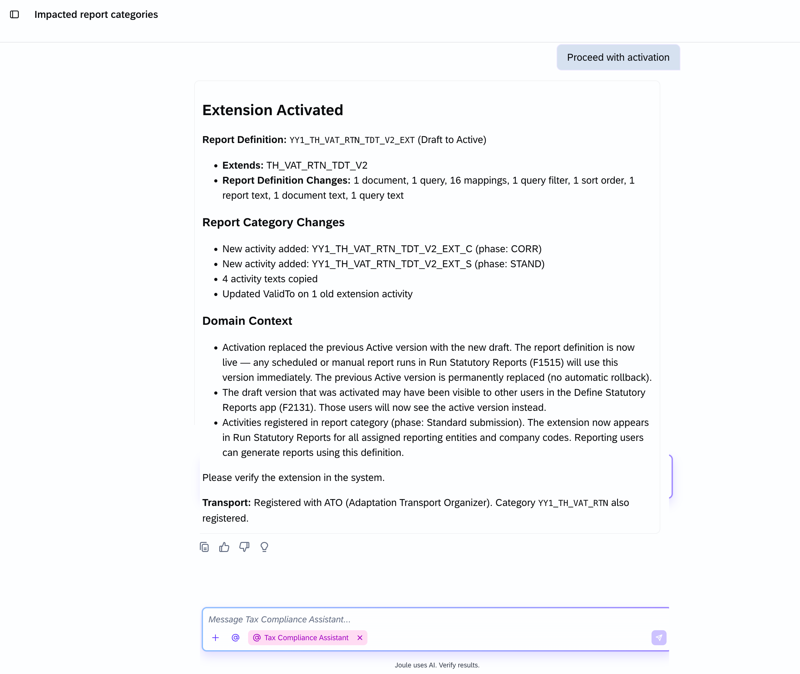

## Statutory Report Extension Update Agent

**Identifier:** J1703 | [Discovery Center](https://discovery-center.cloud.sap/protected/index.html#/ai-agent/5c614b94-5f1a-4116-9981-c079eaf24a52/)

### Objective

Merges customer extensions when SAP releases new statutory report versions, reducing manual work and the risk of losing customer-specific customizations during statutory report upgrades. The agent automates the reconciliation between the new SAP-delivered version and existing customer extensions.

### What It Can Do

- Detect new SAP statutory report versions that require extension updates
- Automatically merge customer-specific extensions with the updated SAP version
- Identify conflicts between customer extensions and new statutory report versions
- Reduce manual effort and risk during statutory report version upgrades

### Works With

- SAP S/4HANA Cloud Public Edition

### Example Prompts

| Prompt |
|--------|
| "Update the extension for statutory report [report name] to the latest SAP version." |
| "Show me conflicts between my extensions and the new version of [report name]." |
| "Merge my customer extensions for [report name] with the new SAP version." |

> **Note:** Full capabilities and example prompts will be updated here once additional documentation becomes available.

## Screenshots

