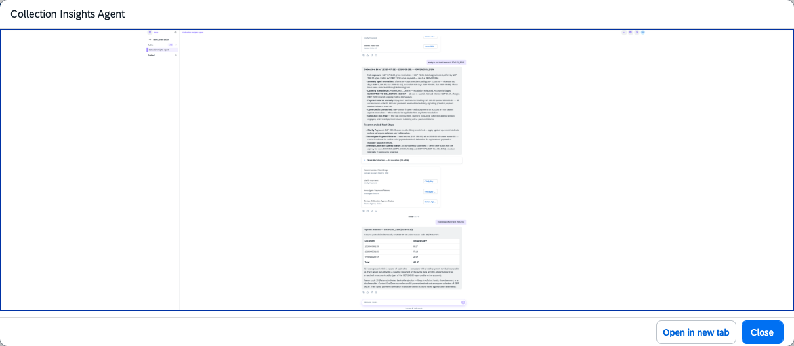

## Collection Insights Agent

### Objective

Supports collection processes in contract accounting by delivering intelligent account insights based on deep account balance analysis, customer payment behaviour, and past collection activities.

### Prerequisites

- Contract Accounting (FI-CA) module active
- SET/GET parameter 8RA (FI-CA: Options for Clearing Reset) defined in user profile via transaction SU3

### What It Can Do

- Analyse contract account balances and identify overdue items
- Review customer payment behaviour and historical collection activities
- Provide actionable recommendations for credit clarifications
- Identify missing payments and allocation gaps
- Suggest next steps such as promise-to-pay commitments or instalment plans

### Example Prompts

| Prompt |
|--------|
| "Show me the collection insights for contract account CA-10001" |
| "What is the payment behaviour of customer C-10001 across their contract accounts?" |
| "Which contract accounts in my worklist have missing payments or require credit clarification?" |

  

*Figure – Collection Insights Agent in action (Source: SAP Discovery Center)*
