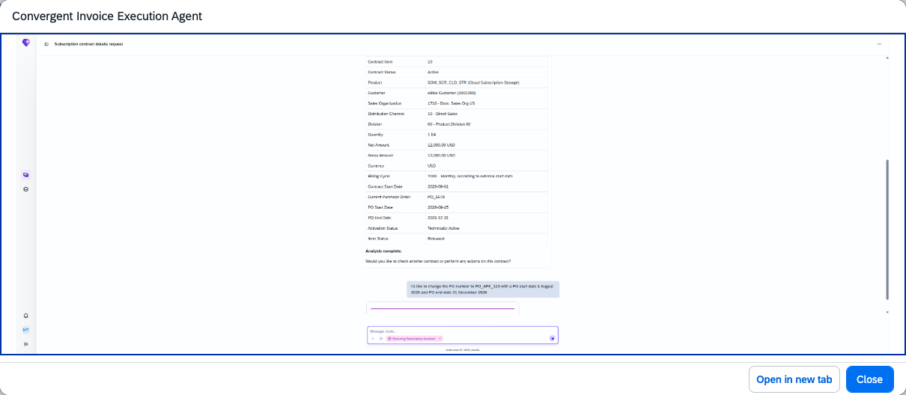

## Convergent Invoice Execution Agent

### Objective

Automates invoice corrections by detecting issues, recommending next-best actions, and executing geo-aware, regulation-compliant correction processes including rebilling and invoice reprinting.

### Prerequisites

- Business role `SAP_BR_INVOICING_SPEC_CINV` (Invoicing Specialist – Convergent Invoicing) assigned
- SAP Note 3803943 implemented

### What It Can Do

- Detect errors and issues in convergent invoices
- Recommend next-best correction actions based on issue type
- Execute geo-aware correction processes that respect local regulations
- Automate backend transactions for rebilling and invoice reprinting
- Reduce invoice reprocessing time and billing-related dispute volumes

### Example Prompts

| Prompt |
|--------|
| "Check invoice CI-100456 for errors and recommend the appropriate correction" |
| "Execute a regulation-compliant rebill for the incorrect invoice CI-100457" |
| "Show me all convergent invoices with open correction actions in billing unit BU-001" |

  

*Figure – Convergent Invoice Execution Agent in action (Source: SAP Discovery Center)*
