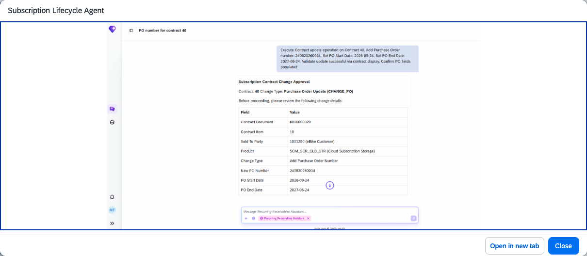

## Subscription Lifecycle Agent

### Objective

Streamlines and standardises subscription contract management by providing a unified capability to retrieve, validate, simulate, and execute subscription changes from search to execution.

### Prerequisites

- Business role `SAP_BR_INTRNAL_SALESREP_SOM` (Internal Sales Representative – SOM) assigned
- The following MCPs active: 251API_SUBSCRIPTIONCONTRACT, 251UISUBSCRPNMASSPROCGMANAGE, 251SUBSCRPNBILLINGCYCLEVH, 251SUBSCRPNCANCELLATIONRSNVH, 251SUBSCRPNEXTDURATIONVH
- SAP Note 3748784 implemented (required before changing PO references in subscription contracts)

### What It Can Do

- Retrieve and validate subscription contract details
- Automatically resolve dependencies and verify contract eligibility for changes
- Determine the appropriate change process based on business context
- Simulate and execute subscription contract changes
- Reduce manual validation steps and parked invoices

### Example Prompts

| Prompt |
|--------|
| "Show me the details and current status of subscription contract SC-100123" |
| "Simulate an upgrade from the Basic to Premium plan for subscription SC-100123" |
| "Process the renewal for subscription contract SC-100124 effective next month" |

  

*Figure – Subscription Lifecycle Agent in action (Source: SAP Discovery Center)*
