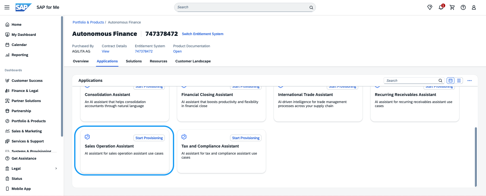
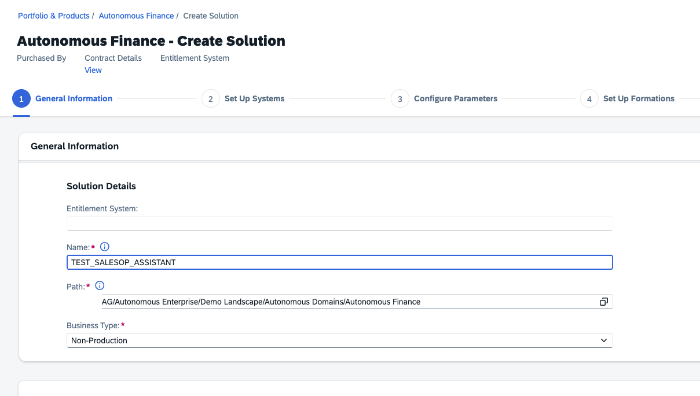
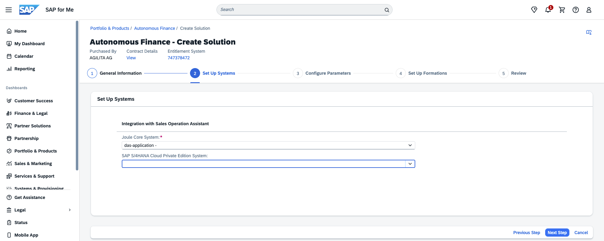
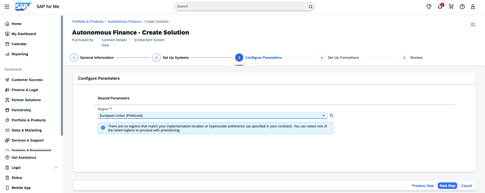

## Provision Sales Operations Assistant in SAP for Me

Once all pre-requisites are in place, the Sales Operations Assistant is activated through SAP for Me.

**Step 1 – Log in to SAP for Me**

Go to [https://me.sap.com](https://me.sap.com) and sign in with your S-user ID.

**Step 2 – Navigate to the Autonomous Enterprise**

From the sidebar, select **Portfolio & Products**, then open **My Product Packages** and select the catalog **Autonomous Enterprise**. This lists all available Autonomous Enterprise areas — select **Autonomous Finance**.

**Step 3 – Locate the Sales Operations Assistant**

In the feature list, find **Sales Operations Assistant** under Autonomous Finance.

  

**Step 4 – Start Provisioning**

Select the feature and click **Start Provisioning**. SAP for Me will guide you through the activation wizard.

  

  

  

**Step 5 – Confirm Activation**

Once SAP processes the request, the assistant becomes available in your Joule interface on SAP S/4HANA Cloud Private Edition.
