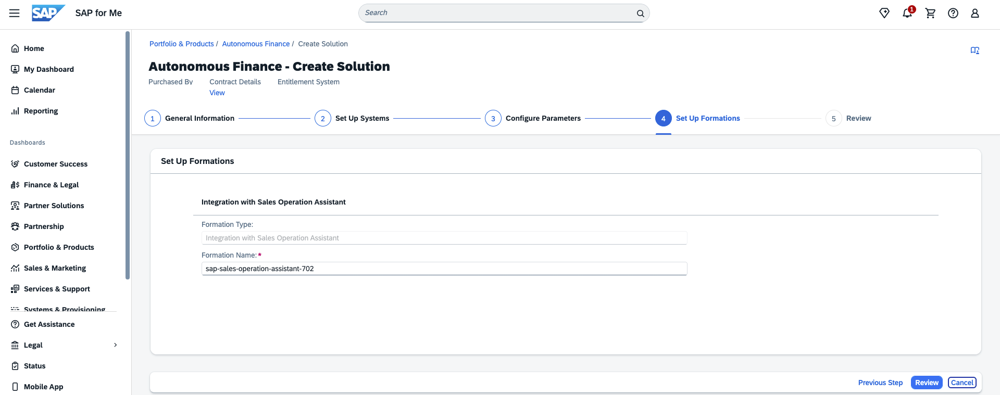

## Assign Users in SAP Cloud Identity Services

After the Sales Operations Assistant is provisioned, users must be added to the appropriate group in SAP Cloud Identity Services (CIS) to gain access to Joule and the Sales Operations Assistant.

**Step 1 – Open the CIS Admin Console**

Log in to your CIS tenant admin console:
```
https://<your-tenant>.accounts.ondemand.com/admin
```

**Step 2 – Navigate to Groups**

Go to **Users & Authorizations → Groups**.

**Step 3 – Locate the Joule End User Group**

Search for the group `joule_end_user`.

**Step 4 – Add Users**

Select the group, click **Add User**, and add the users who require access to the Sales Operations Assistant.

**Step 5 – Run IPS Synchronisation (if applicable)**

If Identity Provisioning Service (IPS) is configured, run the **Read Job** to synchronise users and roles from SAP S/4HANA to SAP Build Work Zone.

**Step 6 – Verify Access**

Have a test user log in to Joule via SAP Build Work Zone and confirm the Sales Operations Assistant is available.

<p align="center">
  
</p>
