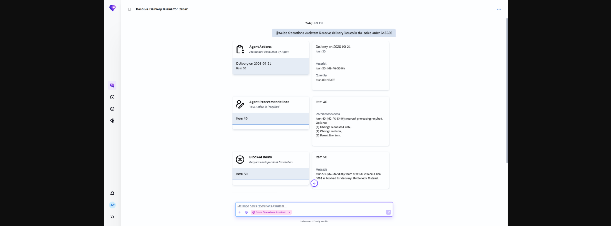

## Delivery Issues Resolution Agent

### Objective

Identifies sales orders blocked for delivery and proposes corrective actions to unblock fulfilment. The agent analyses the block reason and the available inventory or scheduling options, then presents one or more resolution options for approval.

### What It Can Do

- Display delivery block reasons at header and item level
- Show item count per block reason
- Propose an outbound delivery with the quantity currently available (partial delivery)
- Suggest an alternative product when the ordered material is unavailable
- Recommend adjusting the requested delivery date to align with available stock

### Example Prompts

| Prompt |
|--------|
| "Are there any delivery issues with sales order 50004567?" |
| "What is the delivery block reason for sales order 50004567?" |
| "Suggest a resolution for the delivery block on sales order 50004567." |
| "Can we do a partial delivery for sales order 50004567?" |
| "Which items on sales order 50004567 have a delivery block?" |

  

*Figure – Delivery Issue Resolution Agent in action (Source: SAP Discovery Center)*
