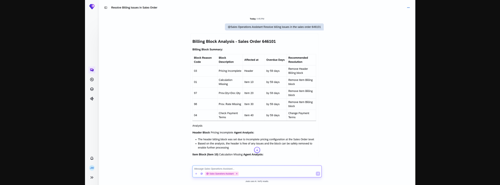

## Billing Block Resolution Agent

### Objective

Identifies sales orders with an active billing block and recommends the corrective action needed to allow invoice creation. A billing block prevents the generation of a billing document until the underlying issue is resolved.

### What It Can Do

- Display billing block reason and the level at which it is applied (header or item)
- Show item count per block reason
- Recommend corrective actions such as updating payment terms or completing missing pricing data
- Remove the billing block once the underlying issue is resolved (with approval)

### Example Prompts

| Prompt |
|--------|
| "Does sales order 50004567 have a billing block?" |
| "Show me the billing block details for sales order 50004567." |
| "What is causing the billing block on sales order 50004567?" |
| "How do I resolve the billing block on sales order 50004567?" |
| "Remove the billing block on sales order 50004567 if payment terms are correct." |

  

*Figure – Billing Block Resolution Agent in action (Source: SAP Discovery Center)*
