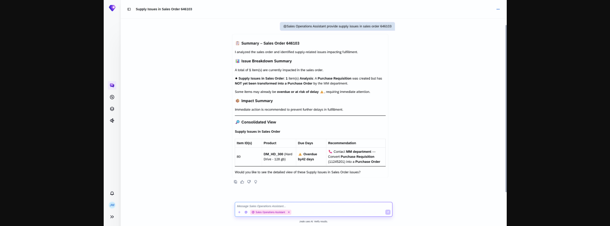

## Supply Issue Resolution Agent

### Objective

Analyses supply-related problems that prevent or delay fulfilment of a sales order. The agent evaluates both procurement and manufacturing supply chains to determine the root cause and expected resolution timeline.

### What It Can Do

- Evaluate supply issues across procurement (purchase orders, contracts) and manufacturing (production orders)
- Check expected production or procurement availability dates
- Link to related documents — production orders, purchase orders — for further investigation
- Show overdue billing days for blocked sales orders to support prioritisation

### Example Prompts

| Prompt |
|--------|
| "Are there any supply issues with sales order 50004567?" |
| "Why is there a supply problem for the material on sales order 50004567?" |
| "What is the expected availability date for the material on sales order 50004567?" |
| "Show me the related procurement and production documents for sales order 50004567." |
| "Which sales orders are affected by supply issues this week?" |

  

*Figure – Supply Issue Resolution Agent in action (Source: SAP Discovery Center)*
