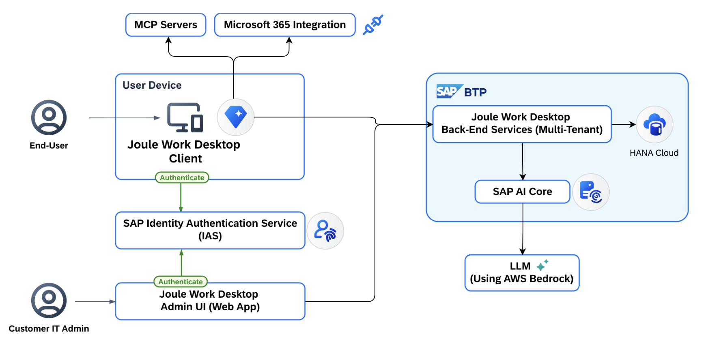

## Joule Work Desktop — Solution Overview

**Joule Work Desktop (JWD)** is an AI-powered desktop application that helps business users complete everyday work more efficiently by bringing research, analysis, summarization, drafting, and contextual assistance into one secure workspace.

JWD works across local files, business applications, and email and calendar data. It supports both text-based and voice-based interactions while maintaining enterprise-grade security and data protection.

### Key Capabilities

- **MCP Connectors** — Connect to external systems to retrieve data
- **Summarization** — Summarize documents, emails, and meeting notes
- **Spaces** — Create focused workspaces combining relevant data and context
- **Custom Skills** — Define repeatable tasks such as email triage, drafting, and report preparation
- **Mail & Calendar** — Read and interact with your Microsoft 365 mailbox and calendar
- **Voice Interaction** — Voice-based input alongside text

### System Landscape

The diagram below illustrates the key components involved in Joule Work Desktop.

  

The key components are:

- **JWD Desktop Client** — The desktop application installed on end-user machines (customer-managed)
- **JWD Back-End Services** — Core backend services hosted on SAP BTP (SAP-managed, multi-tenant)
- **SAP Identity Authentication Service (IAS)** — Manages user authentication and authorization (customer-managed)
- **SAP AI Core** — AI inference engine powering JWD capabilities (SAP-managed)
- **MCP Servers** — External connectors for data retrieval (customer or third-party managed)
- **Microsoft 365 Integration** — Optional email and calendar access via Microsoft Entra

For detailed component documentation, see the [SAP Help Portal: Technical System Landscape](https://help.sap.com).

### Setup Process at a Glance

In this mission, we will walk you through the following phases:

1. **Prepare** — Confirm prerequisites and understand the user roles created during provisioning
2. **Set Up** — Provision JWD in SAP for Me, download and install the JWD client, configure users and groups in SAP Cloud Identity Services, and optionally configure administrator settings and Microsoft Outlook integration
3. **Develop** *(optional)* — Develop and connect MCP servers using SAP Integration Suite
4. **Complete** — Share your feedback and mark the mission as done
