## Provision Joule Work Desktop in SAP for Me

This step is performed by an SAP administrator with S-User privileges on [me.sap.com](https://me.sap.com).

### Step 1 — Navigate to Portfolio & Products

Log in to [https://me.sap.com](https://me.sap.com). In the left navigation panel, click **Portfolio & Products**.

  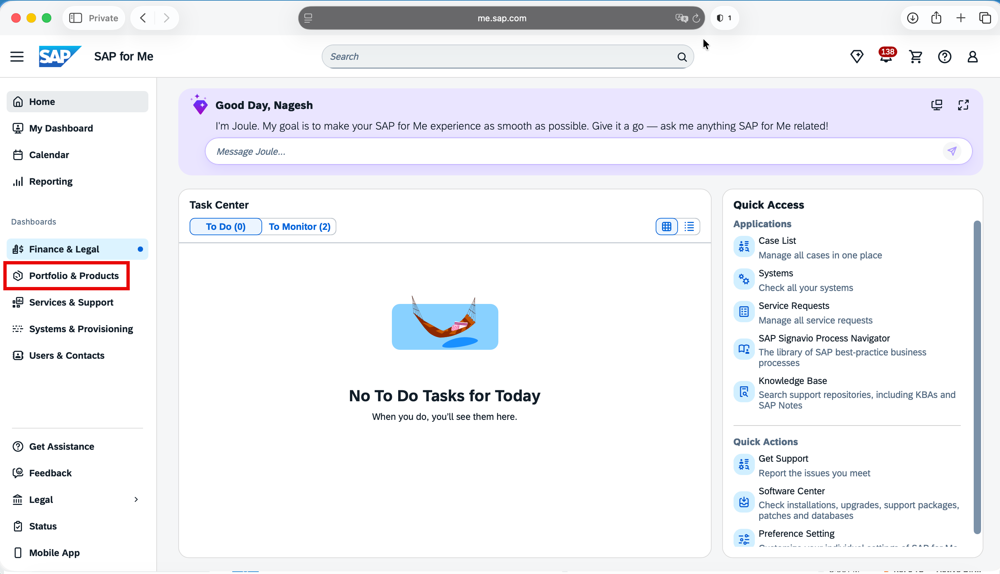

Click on **My Product Packages**, select **Artificial Intelligence**, and then click on **Joule**.

  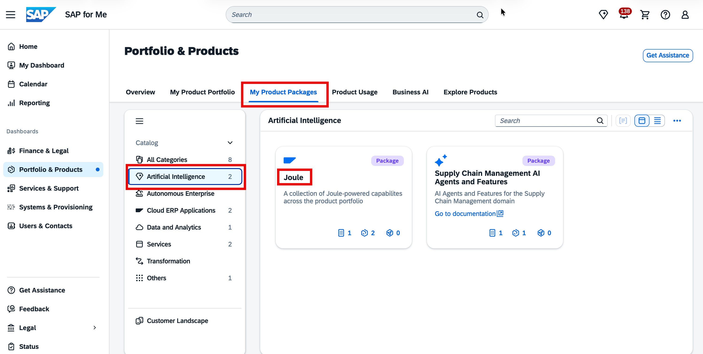

### Step 2 — Start Provisioning

On the Joule product page, locate **Joule Work Desktop** and click **Start Provisioning**.

  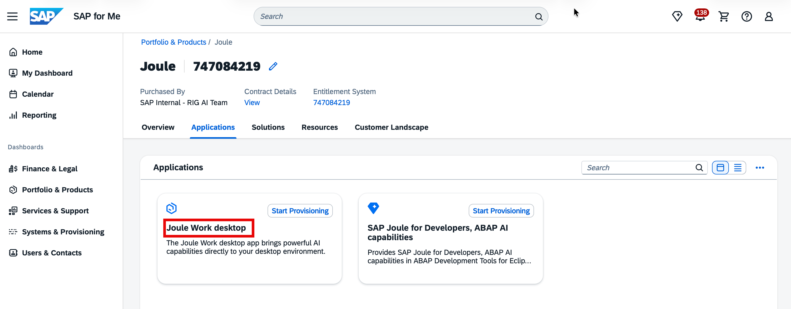

### Step 3 — General Information

In the **General Information** page of the wizard, enter a recognizable name for your JWD setup (for example, `JWD-<your-org-name>`), select or create a **Resource Group** as the target container, and set the **Business Type** to `Production`.

  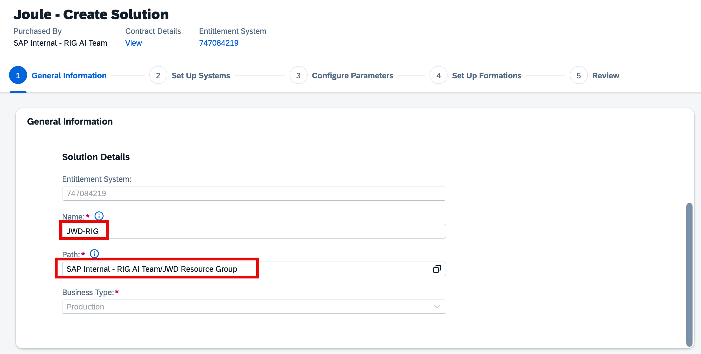

If you do not have an existing resource group, click the **Select Resource Group** icon and then click **Create resource group**. Enter a name (for example, `JWD Resource Group`).

  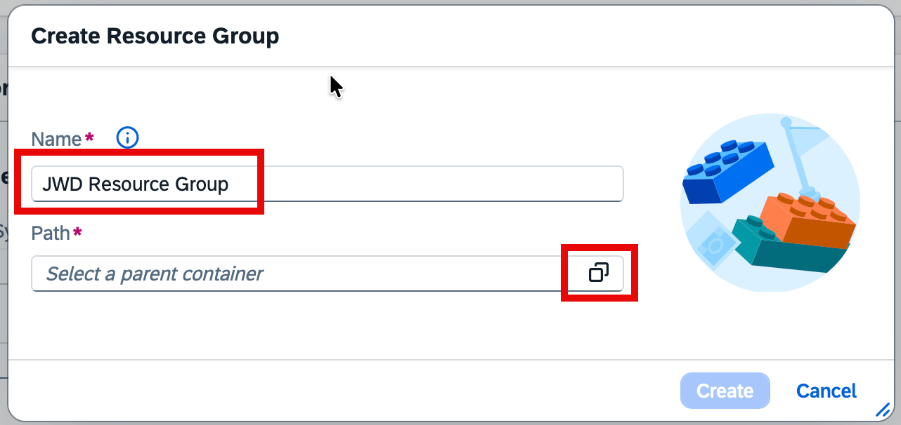

Set the path to your organization by clicking the path icon and selecting your org.

  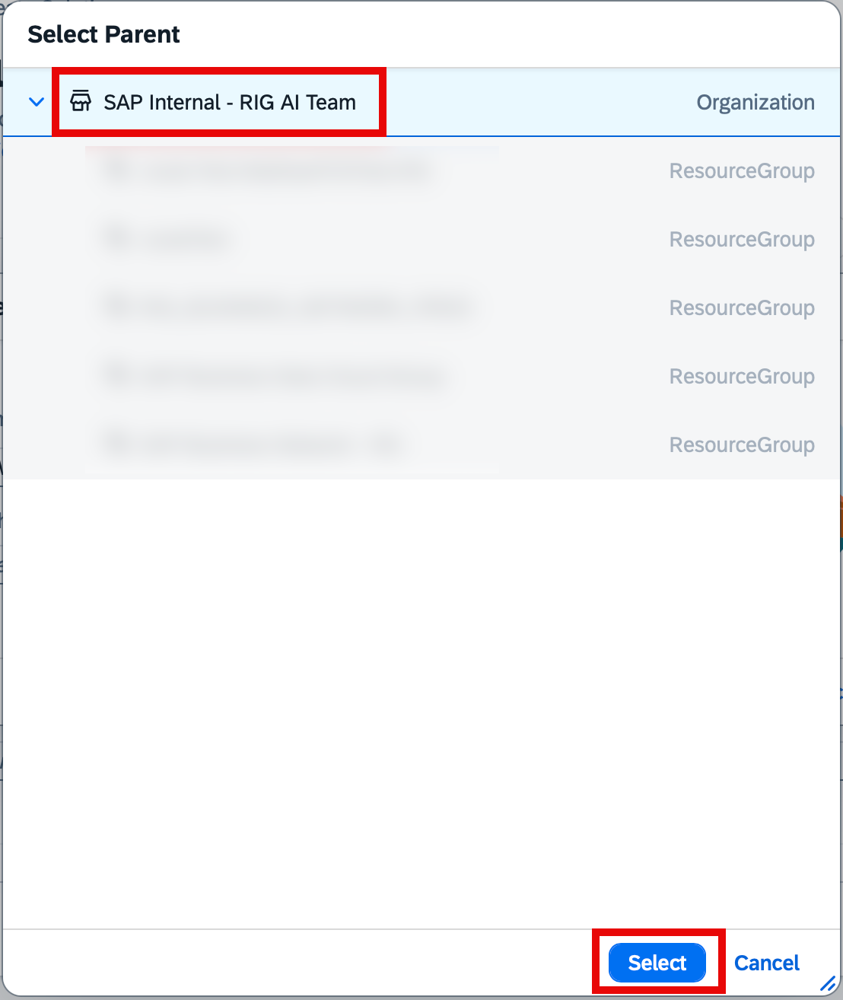

Click **Create**.

  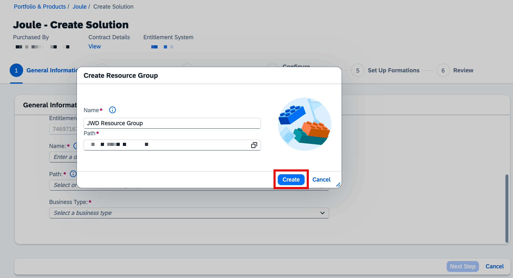

Once the resource group is selected, click **Next Step**.

  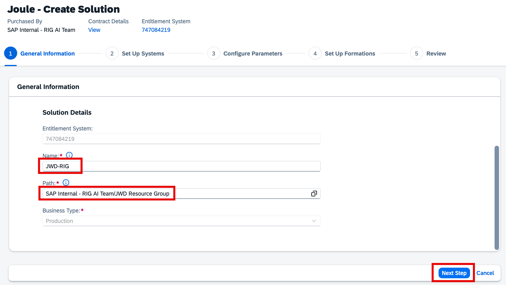

> **Tip:** Organize your provisioning resources using nested folders and resource groups. If your account hierarchy is not yet set up, close the wizard and configure it in the **Resources** tab first.

### Step 4 — Set Up Systems

In the **Set Up Systems** page, under **Integration with SAP Cloud Identity Services**, select your productive IAS tenant. Ensure it is the tenant used for your organization's rollout, then click **Next Step**.

  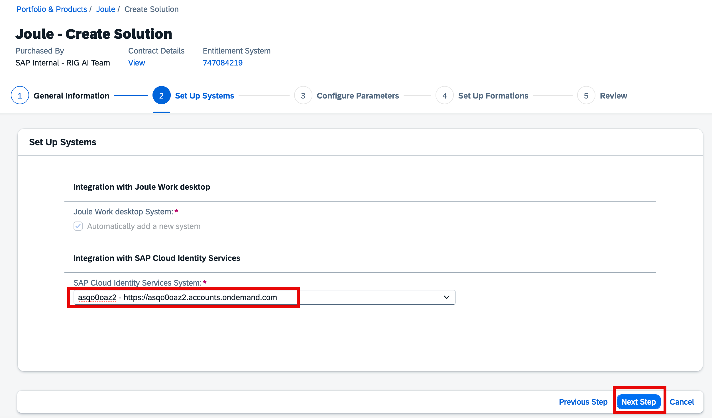

### Step 5 — Configure Parameters (Region)

Select the hosting region for JWD services. Currently, only **EU10** and **US10** are supported. Germany (EU10) is the recommended option. Click **Next Step**.

  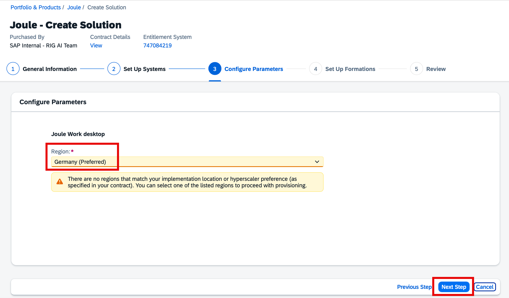

### Step 6 — Set Up Formations

A pre-populated formation name is shown (for example, `sap-joule-work-desktop-c2a-rig`). You may modify this name if needed. Click **Review**.

  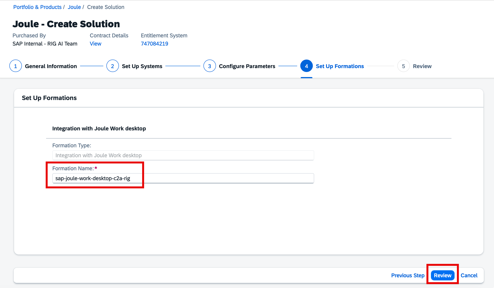

### Step 7 — Review and Finish

Review all selected options — General Information, Set Up Systems, Configure Parameters, and Set Up Formations. If everything looks correct, click **Finish**.

  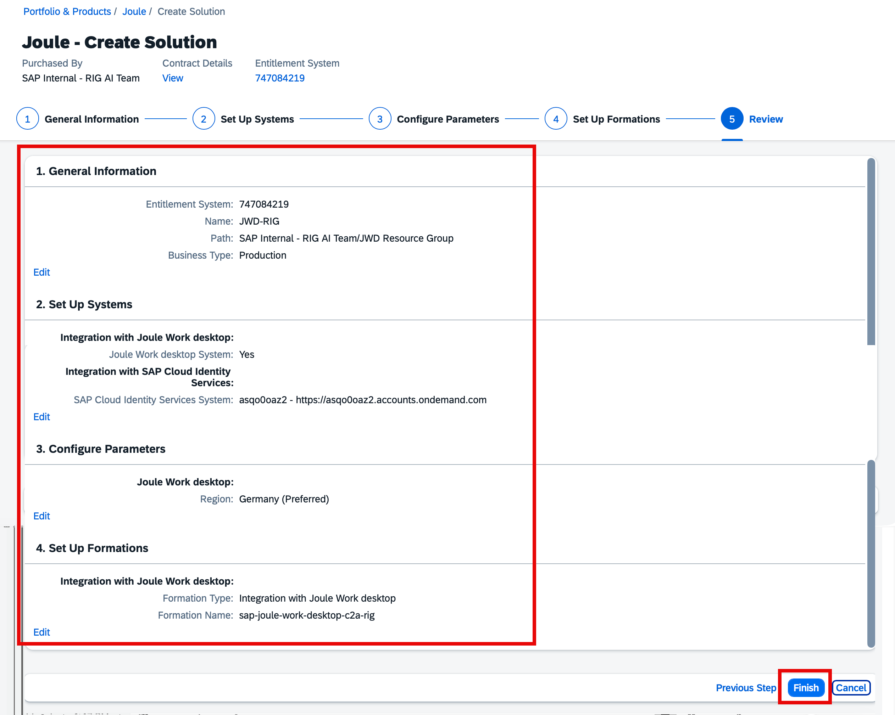

### Monitoring Provisioning Status

After clicking **Finish**, a confirmation dialog confirms that the provisioning request has started. Click **View in Resources** to monitor progress.

  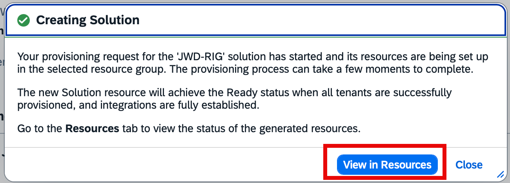

Provisioning typically takes 10–15 minutes. Find the JWD entry in your resource path and wait for the **Ready** status.

  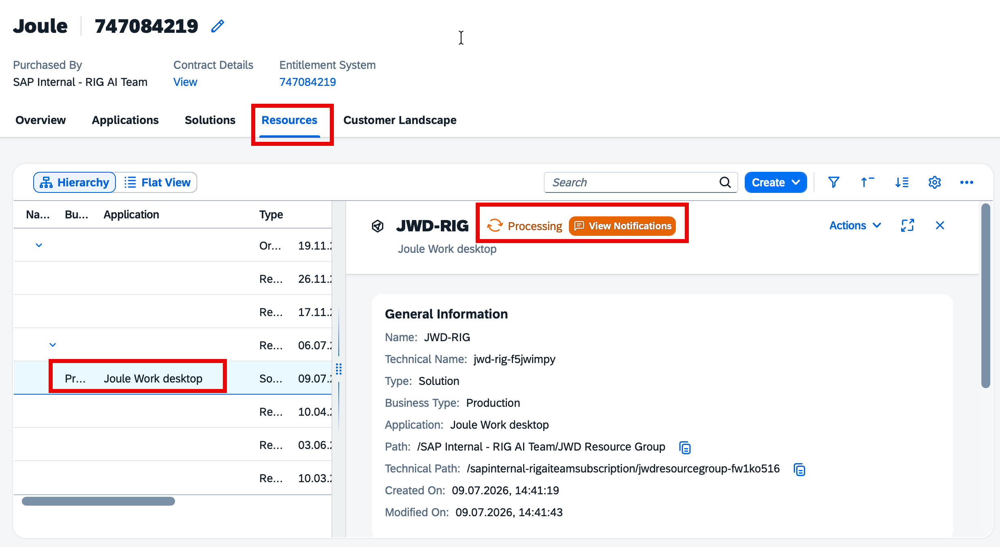

Click on the JWD solution entry to view its details — the name, technical name, path, and provisioned tenant are shown in the panel on the right.

  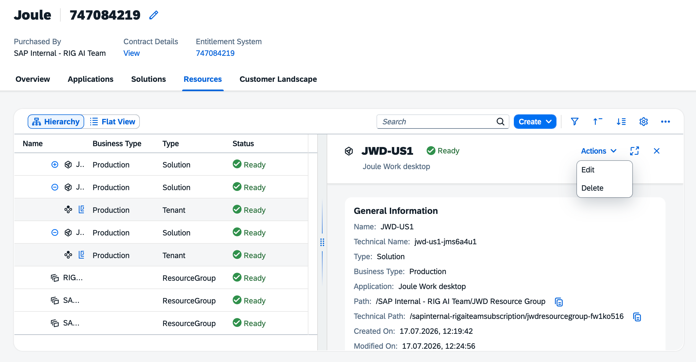

### Access Information

Once provisioning is complete with **Ready** status, click on the JWD tenant entry in the Resources tab. Locate the **Access Information** section and copy the **Main URL** — this is your JWD Gateway URL.

  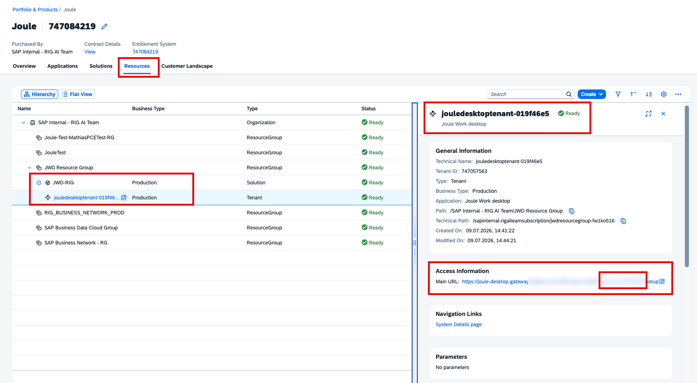

> **Note:** Save this URL — you will need it after installing the JWD client and completing IAS role assignments in the next steps.
