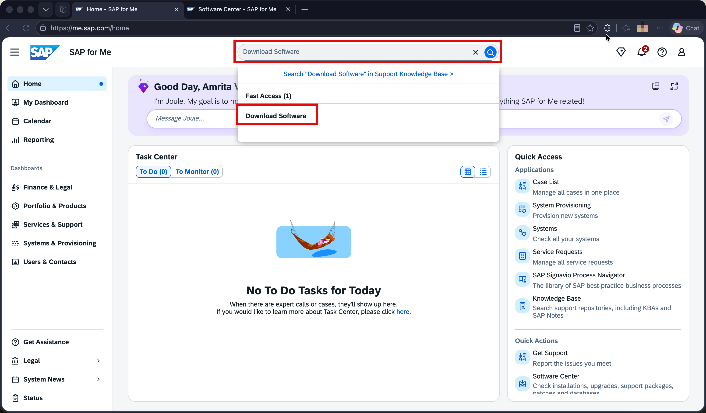
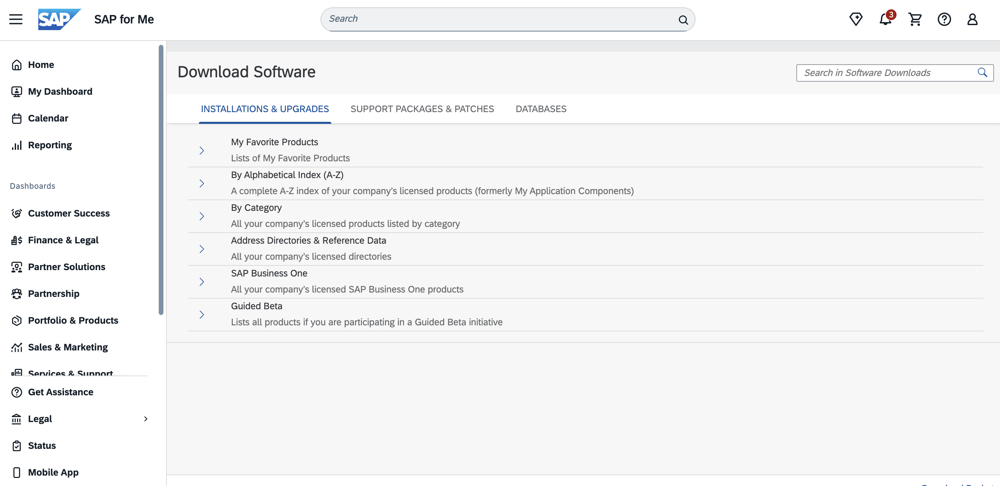
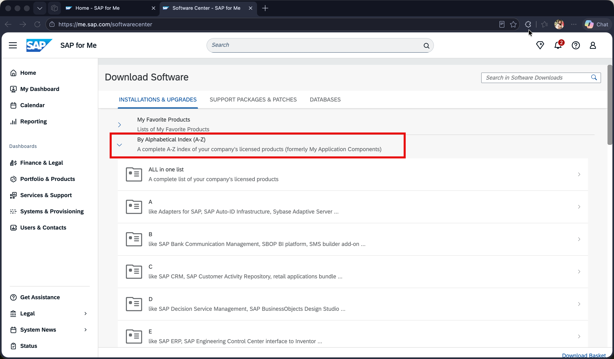
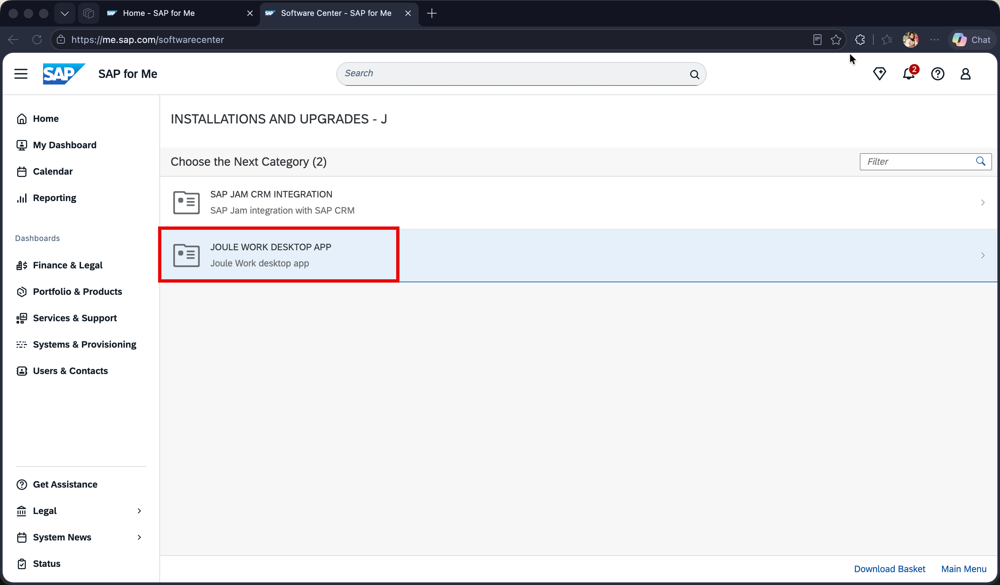
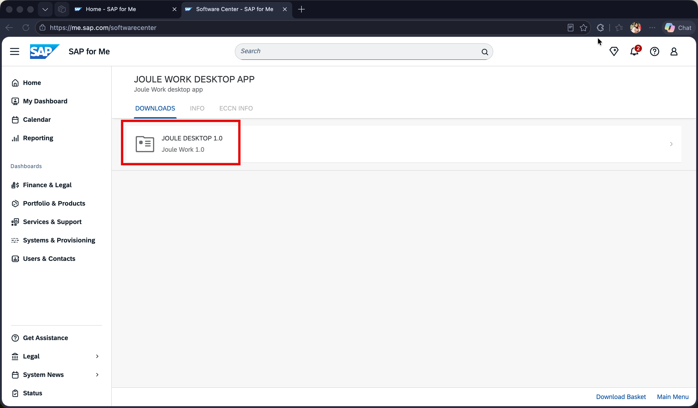
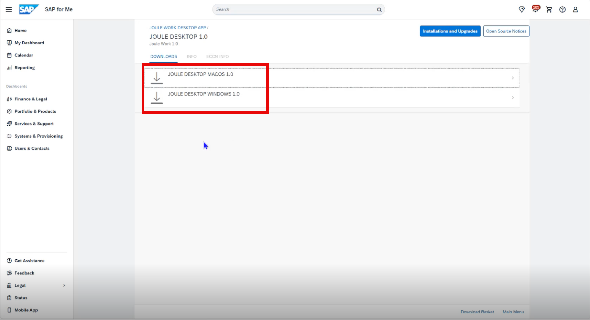
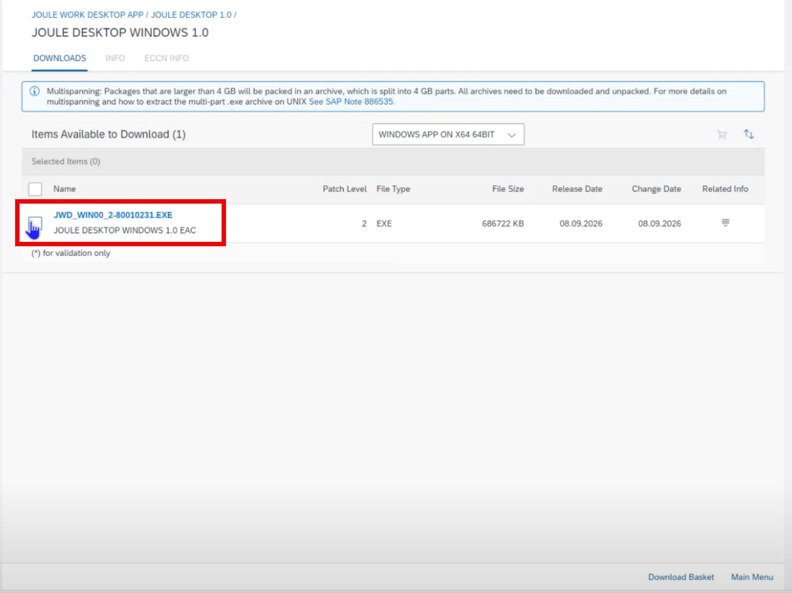

## Download and Install Joule Work Desktop

After provisioning completes, you can download the JWD desktop client from the **SAP for Me Software Center**.

### Step 1 — Open Software Center in SAP for Me

Log in to [https://me.sap.com](https://me.sap.com). In the top search bar, type **Download Software**.

  

Click the **Download Software** result under **Fast Access** to open the Software Center.

  

### Step 2 — Navigate to Joule Work Desktop

In the Software Center, expand **By Alphabetical Index (A-Z)** and click the letter **J**.

  

### Step 3 — Select the Product

Select **JOULE WORK DESKTOP APP** from the product list.

  

Select **JOULE DESKTOP 1.0** from the version list.

  

On the Downloads tab, select the installer for your operating system — **JOULE DESKTOP WINDOWS 1.0** for Windows or **JOULE DESKTOP MACOS 1.0** for macOS.

  

### Step 4 — Download the Installer

Click the filename to start the download. For example, on Windows the file is named `JWD_WIN00_2-80010231.EXE` (approximately 686 MB).

  

### Step 5 — Install the Application

Once downloaded, run the installer for your platform:

- **Windows** — Run the `.exe` installer and follow the installation wizard
- **macOS** — Open the `.dmg` file and drag the application to your Applications folder

After installation is complete, proceed to the next step to assign users to the correct IAS groups before connecting and logging in to the JWD client.
