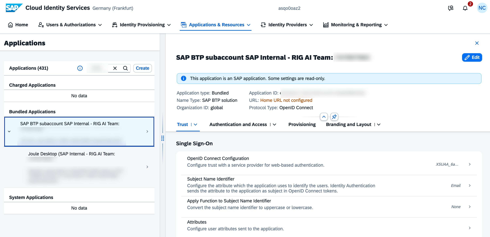
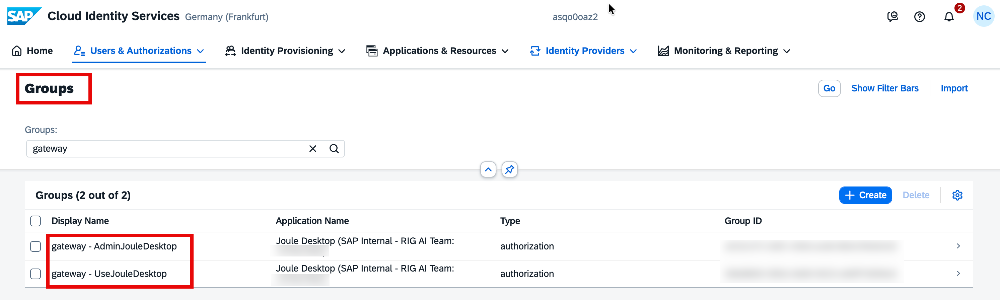
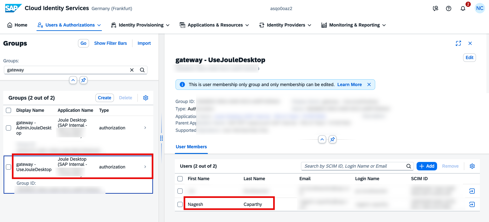
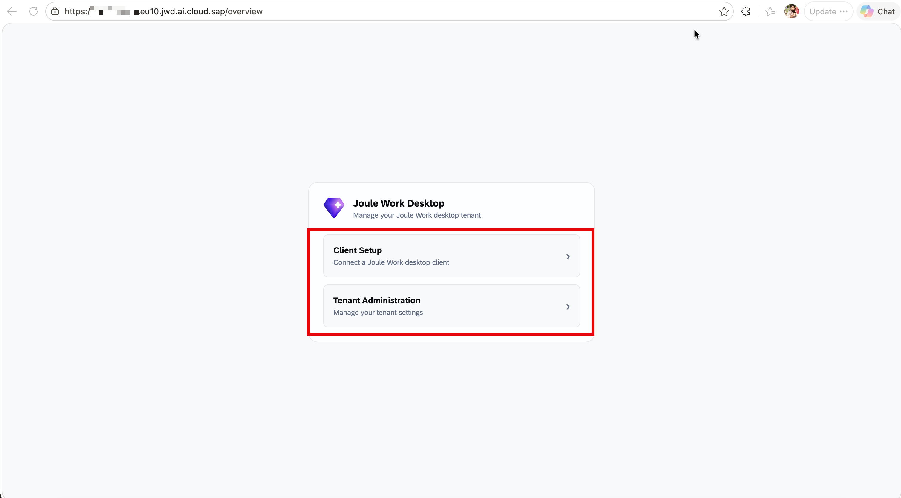
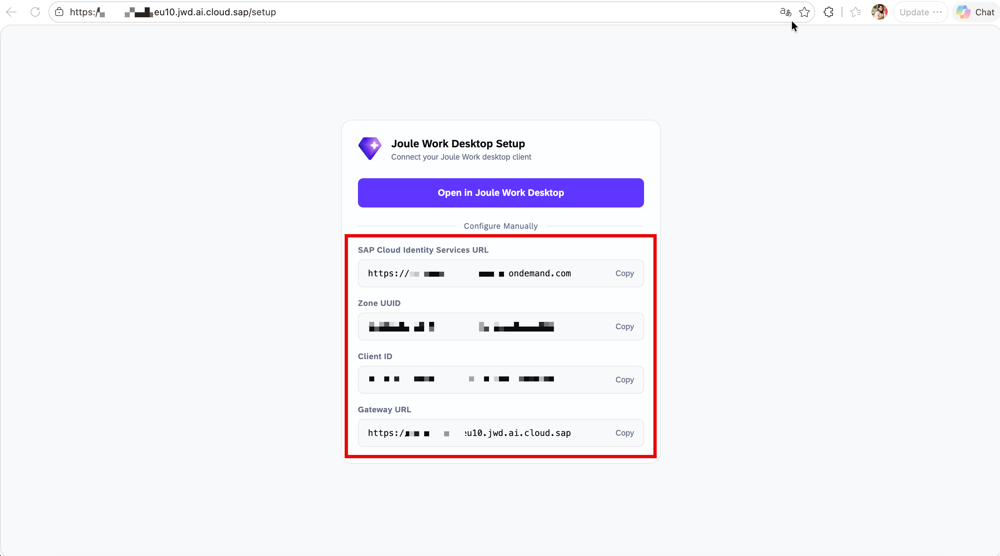
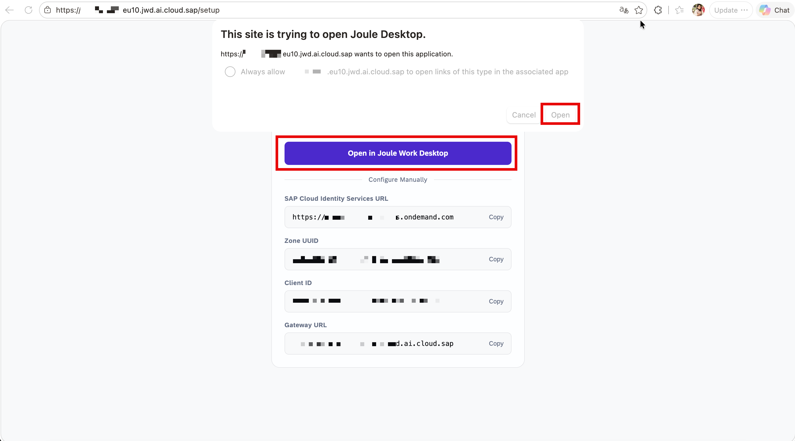
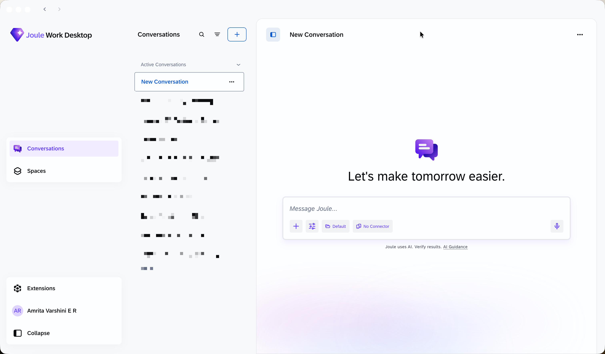

## Configure Users and Groups in SAP Cloud Identity Services

After provisioning, a JWD application and two authorization groups are automatically created in your SAP Cloud Identity Services tenant. In this step, we will validate the setup, assign users to the correct groups, and connect the JWD client to your tenant.

### Step 1 — Locate the JWD Application in IAS

Log in to your SAP Cloud Identity Services admin portal and navigate to **Applications & Resources → Applications**. In the search box, enter the application ID found at the end of your JWD Gateway URL. The JWD application appears as a **Bundled Application** (SAP BTP solution).

  

### Step 2 — Review Application Settings

Click on the application to explore its configuration tabs. The available tabs include Trust (OpenID Connect configuration), Authentication and Access (SSO and conditional authentication rules), Provisioning, and Branding and Layout. Note that some settings may be read-only as this is an SAP-managed bundled application.

### Step 3 — Verify User Groups

Navigate to **Users & Authorizations → Groups** and search for `gateway`. You should see two groups created automatically:

- **`gateway - AdminJouleDesktop`** — authorization group for JWD administrators
- **`gateway - UseJouleDesktop`** — authorization group for standard JWD users

  

If you do not see these groups, wait a few minutes after provisioning and refresh. If they still do not appear, verify that the provisioning status in SAP for Me shows **Ready**.

### Step 4 — Assign Admin User

To grant a user access to the JWD Admin Portal, click on **`gateway - AdminJouleDesktop`**. Under **User Members**, click **+ Add**, search by SCIM ID, Login Name, or Email, and save.

### Step 5 — Assign End Users

To grant standard users access to the JWD client, click on **`gateway - UseJouleDesktop`**, click **+ Add**, search for the users, and save.

  

> **Important:** Every JWD user — including administrators — must be assigned to `UseJouleDesktop`. Without this group assignment, users will receive an **Access Denied** error when logging in to the JWD client.

### Step 6 — Open the JWD Gateway Page

Retrieve your **Gateway URL** from SAP for Me: navigate to the **Resources** tab under the Joule application, click on your JWD tenant entry, and copy the **Main URL** from the **Access Information** section.

  

Open the URL. The gateway page shows two options: **Client Setup** (connection details for the JWD desktop client) and **Tenant Administration** (manage your JWD tenant settings).

  

Click **Client Setup**. The page shows the connection details including the SAP Cloud Identity Services URL, Zone UUID, Client ID, and Gateway URL.

  

Click **Open in Joule Work Desktop**.

### Step 7 — Allow the Application to Open

A browser prompt will appear asking to open the JWD application. Click **Open**. The JWD client automatically receives the connection parameters (IAS URL, Client ID, Gateway URL).

  

### Step 8 — Log In to the Desktop Client

In the JWD desktop client, the connection details are pre-filled. Click **Connect**.

Authentication follows the flow configured in IAS. With the default IAS authentication flow, enter your email or username on the IAS login screen, click **Continue**, enter your password, and sign in. If Microsoft Entra is configured, you will be redirected to Microsoft Entra for authentication instead.

Upon successful authentication, the browser shows a confirmation and you can return to the JWD application.

### JWD Client Overview

After login, the main JWD interface is ready to use. You can access Conversations for AI interactions, Spaces for context-specific workspaces, Extensions for connectors and MCP servers, and Settings to manage your account and Microsoft 365 integration.

  

For detailed end-user guidance, see the [SAP Help Portal: Joule Work Desktop Users' Guide](https://help.sap.com).
