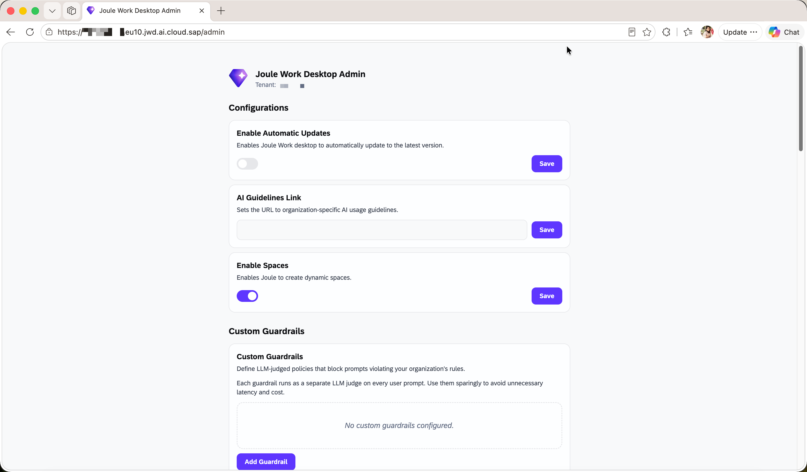
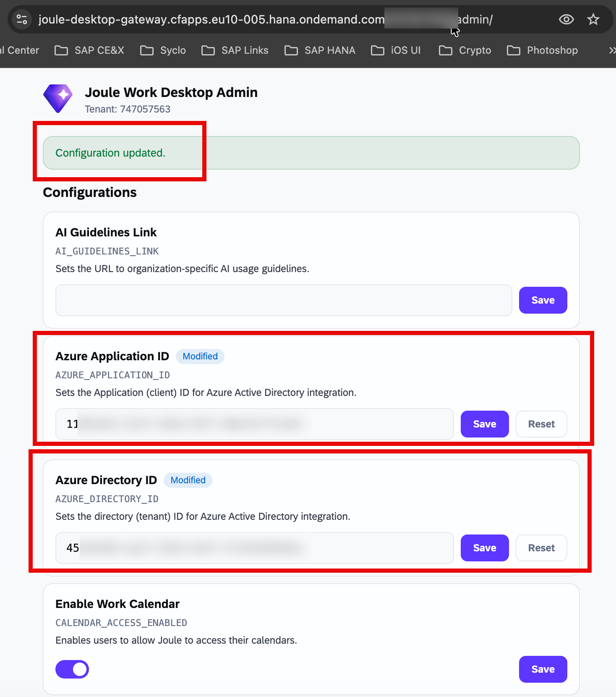

## Configure Administrator Settings

> **Optional** — Complete this step if you want to customize tenant-level behavior for your JWD deployment.

The **JWD Admin Portal** is a web application that allows administrators to manage tenant-level settings for Joule Work Desktop.

### Accessing the Admin Portal

You can access the admin portal via the JWD Gateway overview page by clicking **Tenant Administration**, or by navigating directly to the admin URL using the pattern `https://<TENANT_ID>.<region>.jwd.ai.cloud.sap/admin`. Replace `<region>` with `eu10` or `us10` and `<TENANT_ID>` with the tenant ID from your JWD resources in SAP for Me.

> You must be assigned to the `gateway - AdminJouleDesktop` group in IAS to access this portal.

For the full administration guide, see the [SAP Help Portal: Joule Work Desktop Administration Guide](https://help.sap.com).

  

### Admin Configuration Options

**General Settings**

From the General Settings section you can enable or disable automatic client updates, provide a URL to your organization's AI usage policy, and enable the Spaces feature for users.

**Custom Guardrails**

You can define LLM-judged policies that block prompts violating your organization's rules. Each guardrail runs as a separate LLM judge on every user prompt. Click **Add Guardrail** and enter the policy description.

> **Note:** Use guardrails sparingly to avoid unnecessary latency and cost.

**Quota Management**

The Quota Management section shows the total monthly message usage across all users and allows you to set the maximum number of messages per user per day (the default is 1,000).

**Microsoft 365 Integration**

This section connects JWD to your Microsoft 365 environment. After completing the Microsoft Outlook integration setup (step 3.5), return here to enter the **Microsoft 365 Application ID** (client ID) and **Microsoft 365 Directory ID** (tenant ID) from your Azure App Registration. Toggle on **Enable Work Email** and **Enable Work Calendar**, enter both IDs, and click **Save** next to each field.

  

> **Note:** Work Email is auto-enabled in the JWD client after saving. Work Calendar must be toggled on manually by each user in their JWD Settings.

**Custom Marketplace**

You can provide a custom extension marketplace for your organization by entering a display name and the URL to your marketplace.

**MCP Servers**

In this section you can add and manage Model Context Protocol (MCP) servers that extend JWD with access to external data sources. Click **Add MCP Server** or **Add MCP Access Policy** to configure. For guidance on building custom MCP servers, see the Develop section of this mission.

**Data Export**

Click **Download JSON Export** to export all tenant data in structured JSON format. The export includes tenant metadata and all configuration settings.
